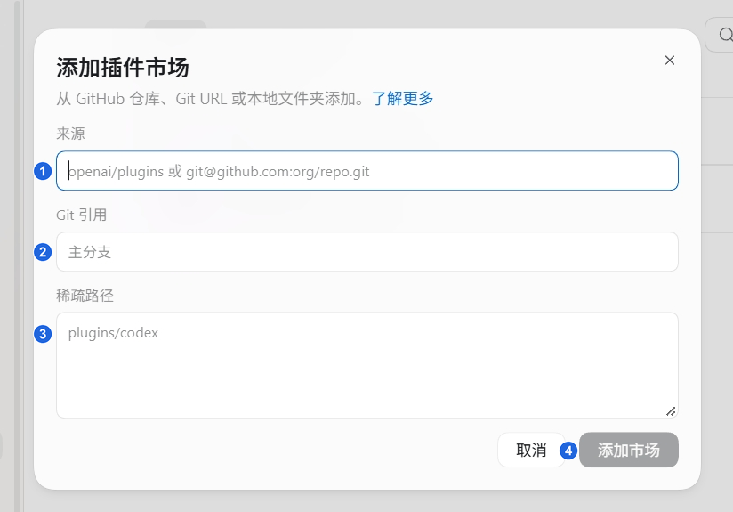

# Full Test · 全流程测试 Skill

面向 **ChatGPT 桌面客户端与 Codex** 的中文优先测试 Skill：从需求生成用例，执行 UI 冒烟和接口测试，合并生成有证据的离线报告。按需使用其中一个阶段，也可以串起全流程。

**版本 0.1.0 · MIT · Python 3.10+ 标准库助手 · 不要求额外 AI API Key。** UI 自动化需要当前客户端可用的浏览器工具，或项目安装的 Playwright。

## 能做什么

| 阶段 | 输入 | 产物 |
|---|---|---|
| 用例生成 | PRD、用户故事、OpenAPI、现有项目 | 正常/边界/异常/鉴权用例、风险优先级、需求追踪 |
| UI 冒烟 | 网址、账号、关键业务流程 | 实际页面操作、可见断言、截图/Trace、执行结果 |
| 接口测试 | API 契约或显式请求计划 | HTTP/JSON/文本/耗时断言、鉴权和负向用例结果 |
| 测试报告 | UI/API/手工结果 | HTML、Markdown、JUnit XML、JSON 摘要 |

区分 `PASS / FAIL / BLOCKED / SKIPPED / NOT_RUN`。未执行和环境阻塞不会算作通过；重试通过保留 flaky 信息。内置 API Runner 是小型显式 HTTP 执行器；复杂契约、动态认证和负载测试沿用项目框架。

## 在客户端安装

本仓库同时提供标准 Skill 文件夹与插件清单。官方支持方式见 [Build skills](https://learn.chatgpt.com/docs/build-skills) 和 [Package your plugin](https://developers.openai.com/plugins/build/plugins)（核实日期：2026-11-13）。客户端可用入口受版本和工作区设置影响。

完整步骤见 **[PDF 图文教程](docs/codex-plugin-guide.pdf)**，或下载 **[带复制按钮的 HTML 教程](docs/codex-plugin-guide.html)** 后用浏览器打开。教程共 11 页，面向普通用户从设置入口开始，包含真实表单截图、字段填写、安装调用、没有 CLI / skill-installer 的备用方案，以及连接失败排障。

### 方式一：在 Codex 图形界面添加 Git 市场（推荐）

**没有 Codex CLI、没有 skill-installer，也可以使用这个方式。** 按当前客户端显示的文字操作；不同版本可能使用“插件仓库”或“插件市场”等标签。

1. 点击 **设置**。
2. 点击 **插件**。
3. 点击 **添加插件仓库**或**添加插件市场**，打开添加表单。
4. 填写以下内容：

   | 字段 | 填写内容 |
   |---|---|
   | 来源 / Git 仓库地址 | `https://github.com/ailiana/Full-test-skill.git` |
   | Git 引用 | `main` |
   | 稀疏路径 | **留空**；表单里的 `plugins/codex` 是占位示例，不要填入 |

5. 点击 **添加市场**，等待仓库获取完成。
6. 在插件目录选择 **ailiana 插件市场**，找到 **Full Test**，点击安装并确认已启用。
7. 打开**新聊天**，输入 `使用 full-test，根据这份 PRD 生成测试用例，先不执行。` 验证调用。



读者提供的实际客户端截图，叠加编号说明。灰色占位提示不需要照填；不同版本的入口名称和位置可能略有差异。

添加市场与安装插件是两个步骤：市场成功出现后，仍需安装其中的 Full Test。表单示例和完整界面说明见上方 PDF / HTML 图文教程。

### 方式二：通过 CLI 添加 Git 市场并安装插件

本仓库已包含 `.agents/plugins/marketplace.json`，市场名为 `ailiana-plugins`，插件名为 `full-test`。不需要 skill-installer：

```text
codex plugin marketplace add https://github.com/ailiana/Full-test-skill.git --ref main
codex plugin add full-test@ailiana-plugins
codex plugin list --json
```

重启桌面客户端，打开新聊天后调用 Full Test。也可以仅执行第一条，再到 Plugins Directory 选择“ailiana 插件市场”，打开 Full Test 详情并安装。添加市场和安装插件是两个步骤；支持的 CLI 可用 `codex plugin list --available --json` 查看待安装条目。

### 方式三：让客户端安装仓库中的独立 Skill

在支持 Skill Installer 的客户端输入：

```text
使用 skill-installer，从 https://github.com/ailiana/Full-test-skill
安装 skills/full-test 目录的 Skill。
```

只需安装完整 `skills/full-test` 文件夹；脚本、参考和模板必须一起保留。手工安装可复制到项目的 `.agents/skills/full-test/`，或个人的 `~/.agents/skills/full-test/`。在 ChatGPT 桌面端 Skills 列表检查是否发现；未刷新时重启客户端。

### 方式四：手动复制 Skill 或建立本地市场

仅需要 Skill：通过 Git 或 Download ZIP 获取仓库，把完整 `skills/full-test/` 复制到业务项目的 `.agents/skills/full-test/`；新聊天使用 `$full-test`。不要只复制 SKILL.md，也不要把整个仓库误当作 Skill 文件夹。

需要插件目录管理：把完整插件放到业务项目 `plugins/full-test/`，在项目 `.agents/plugins/marketplace.json` 中添加指向 `./plugins/full-test` 的条目，保留已有市场配置，重启客户端后安装。完整 JSON 与个人 Git URL 市场示例见图文教程。

### Git 市场连接失败时

如果添加市场出现 `OpenSSL SSL_read: Connection was reset, errno 10054`，先检查运行 Codex 的电脑能否通过 Git 正常访问 GitHub，以及 Git 是否使用了可用代理。Windows 系统代理与 Git 代理配置不一定一致；代理的协议、地址和端口应按你自己的软件配置填写。

确认网络可用后重试，保留 TLS 证书校验。仍无法拉取时，可在 GitHub 选择 **Code → Download ZIP**，解压完整仓库后，把添加窗口的“来源”改为本地仓库根目录；Git 引用和稀疏路径留空。目录下应能直接找到 `.agents/plugins/marketplace.json` 与 `plugin.json`。本地来源的更新需重新同步源文件。

### 插件分发格式

根目录 `plugin.json` 使用 Agent Plugins 标准，`.codex-plugin/plugin.json` 为兼容清单。无需 MCP 服务、API Key 或启动钩子。支持本地插件市场的客户端可以按官方指引将本仓库目录加入市场后安装；**GitHub 仓库可用不等于已经上架公共插件目录**。

只有普通对话/文件能力时，Skill 仍可生成用例和分析已有结果；执行 UI/API 需要相应工具与可访问的测试环境。云端沙箱的 localhost 与你的电脑不同。

## 对话使用

ChatGPT 输入 `@` 选择 **Full Test**；Codex 输入 `$full-test`，也支持按描述自动匹配。

```text
使用 full-test，根据这份 PRD 生成登录模块测试用例，覆盖边界、异常和权限，先不执行。
```

```text
使用 full-test，对当前项目运行 UI 冒烟：登录、搜索、退出。
只报告问题，保留截图和日志，生成 HTML 报告。
```

```text
使用 full-test，根据 openapi.yaml 生成并执行接口测试。
目标为本地测试服务，凭据从环境变量读取，报告通过/失败/阻塞和未覆盖项。
```

```text
使用 full-test，合并这次 Playwright 与 API 结果，生成 HTML、Markdown 和 JUnit 报告。
```

## 本地接口演示（不需要 Node）

在仓库根目录，终端 A 启动仅监听 loopback 的合成页面/API：

```text
python skills/full-test/assets/demo_app.py
```

终端 B 执行：

```text
python skills/full-test/scripts/run_api.py --plan skills/full-test/assets/api-plan.example.json --output test-results/demo/api-results.json
python skills/full-test/scripts/report.py --input test-results/demo/api-results.json --out-dir test-results/demo/report
```

打开 `test-results/demo/report/report.html`。重新运行时选新的结果/报告目录，避免覆盖旧证据。`--dry-run` 不发请求，只产出 NOT_RUN。

三个助手脚本均可 `--help`。退出码 `0`=全部通过；`1`=存在失败；`2`=阻塞/未执行/flaky/输入错误。**失败后仍应生成报告，不要用 `&&` 串联。**

### UI 演示与混合报告

在有 `@playwright/test` 和 Chromium 的项目中，将 `assets/playwright.config.cjs` 与 `assets/ui-smoke.spec.cjs` 复制到同一测试目录。修改目标时同时修改真实业务预期和选择器；示例只验证自带演示页。

在本仓库开发环境中可用：

```text
npm ci
npx playwright install chromium
npx playwright test --config skills/full-test/assets/playwright.config.cjs
python skills/full-test/scripts/import_playwright.py --input test-results/demo/playwright.json --output test-results/demo/ui-results.json --target http://127.0.0.1:8765
python skills/full-test/scripts/report.py --input test-results/demo/api-results.json --input test-results/demo/ui-results.json --out-dir test-results/demo/combined-report
```

浏览器安装是开发演示的依赖步骤，不是 Skill 自动运行的前置仪式。日常使用优先复用客户端浏览器或项目已有框架。截图和 Trace 与结果一起留在运行目录，导入器只接受范围内的附件。

## 设计取舍

从高星项目中吸收渐进加载、关键路径冒烟、从契约生成接口用例、可追溯报告等方法，使用原创指令和代码实现。没有整包复制上游 Skills，也不依赖 Claude 专用工具名称。来源及取舍见 [SOURCES](docs/SOURCES.md)。

凭据通过环境变量/宿主密钥工具传入；助手不记录原始请求/响应。报告文本做尽力脱敏，原始截图和 Trace 分享前仍需检查。默认测试并报告，修复/发布/上传需来自用户的相应授权。

## 开发与验证

```text
python -m unittest discover -s tests -v
python tools/validate.py
python tools/package.py --output-dir dist
```

验证覆盖真实 localhost HTTP 行为、负向断言、写入保护、超时、重定向、重试、Playwright 导入、HTML 注入、证据目录限制及报告统计。生成 `full-test-skill.zip`（独立 Skill）、`full-test-plugin.zip`（含插件清单）与 `full-test-source.zip`（完整源码与测试）。脚本和模板不包含任何外部账号凭据。
